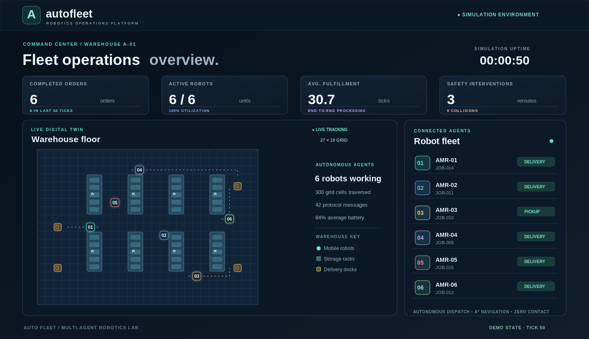
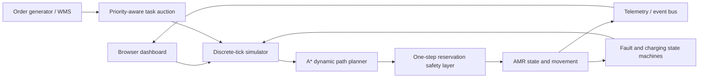

<div align="center">
  

  # AutoFleet

  **Autonomous Warehouse Robot Fleet Simulator**

  A visual, interactive, browser-based digital twin for autonomous warehouse operations. Dispatch a multi-agent robot fleet, route around obstacles, recover from failures, and explore live operational analytics.

  **Zero runtime dependencies** · **Deterministic simulation** · **Works on GitHub Pages** · **Automated tests**
</div>

---

## 🚀 Project preview



*Illustrative dashboard preview generated directly from a deterministic AutoFleet simulation at tick 50. The actual interactive website includes controls, logs, task queues, and performance charts.*

## ✨ Features

| Feature | What it does |
| :--- | :--- |
| **Multi-agent fleet** | Simulates 1–10 autonomous mobile robots (AMRs), each with independent position, battery, mission, and health status. |
| **Dynamic task allocation** | A centralized auction-style dispatcher awards pickup-and-delivery jobs to eligible robots using path-length bids and battery penalties. Higher-priority orders are allocated first. |
| **A* path planning** | Robots calculate Manhattan-heuristic paths through a warehouse grid while avoiding shelving, other vehicles, and failed robots. Routes are recalculated each simulation tick. |
| **Collision avoidance** | A conservative reservation policy forbids two robots from entering the same cell or swapping positions during a tick. Route conflicts generate yield messages. |
| **Fleet communications** | A simulated communication event bus records assignments, route negotiations, pickup confirmations, heartbeats, fault reports, recoveries, charging, and completed deliveries. |
| **Failure simulation** | Inject a motor fault into a selected agent, requeue its job, route other agents around it, and recover the unit automatically or manually. |
| **Energy autonomy** | Low-battery robots travel to dedicated charging areas, recharge, and become available for new work. |
| **Live dashboard** | Visualizes robots, routes, orders, utilization, average fulfillment time, total distance, safety interventions, throughput trends, and battery. |
| **Scenarios** | Standard operations, peak-hour order demand, and a scripted failure drill. |
| **Exportable telemetry** | Downloads a structured JSON report with fleet metrics, job history, robot details, and recent communication messages. |

## ⚡ Quick start

**Requirements:** Node.js 18 or higher for the local server and tests. No `npm install` is required because there are no npm dependencies.

```bash
# Clone after you publish your copy on GitHub
# git clone https://github.com/YOUR_USERNAME/AutoFleet.git
# cd AutoFleet

npm run dev
```

Open **http://localhost:5173** in your browser.

If you prefer not to install Node.js, use a basic HTTP static-file server instead:

```bash
python3 -m http.server 5173
```

Then open the same address. **Do not double-click `index.html`**: some browsers block ES module imports from `file://` URLs. It must be served via HTTP(S).

### Controls

| UI control | Behavior |
| :--- | :--- |
| Start / Pause | Run or pause automatic simulation ticks. |
| Single step | Move the whole simulation forward by exactly one tick. |
| Speed (1×–4×) | Adjust how quickly simulation ticks advance. |
| Add order | Submit a new randomly generated pickup-and-delivery job. |
| Inject failure | Disable the selected robot (or another available agent). |
| Recover | Return all failed robots to service immediately. |
| Scenario | Reset into a new warehouse workload. |
| Show planned paths | Toggle the A* route overlays on the map. |
| Export report | Save current metrics and historical task data as JSON. |

Click a robot on the canvas or in the fleet status list to see its assigned task, position, battery, and completed deliveries. Press **Space** outside form controls to play/pause.

## 🧠 How the simulator works

### 1. Order generation

A warehouse management system (WMS) introduces jobs with a shelving pickup point, a delivery dock, creation time, and priority (**HIGH**, **NORMAL**, **LOW**). The user can add orders manually; scenarios optionally add new orders over time.

### 2. Auction-style assignment

The dispatcher considers idle, battery-eligible agents and finds the robot offering the cheapest bid for each queued job:

```text
bid(robot, job) = shortest_A*_distance(robot → pickup)
                + 0.025 × (100 − battery_percentage)
```

Jobs are processed in priority order, with older jobs winning ties. This is a **greedy centralized auction**, not an optimized multi-robot assignment solver.

### 3. Dynamic A* routing

Each active robot searches for a route toward a valid servicing cell (the target or a directly adjacent walkable cell). A* uses Manhattan distance as its admissible heuristic, and avoids the storage racks and dynamically blocked cells.

```text
A* → valid route → check current occupancy → reserve one next cell → move one grid cell
```

Routes are recalculated at every discrete tick. This reflects an idealized coordinated control layer rather than real-world SLAM, continuous-velocity trajectory control, or ROS 2 navigation.

### 4. Conservative collision prevention

All robots occupy unique cells. The safety controller refuses moves into:

- Shelves or the world boundary.
- Cells occupied by **any** other robot at the beginning of a tick.
- Cells already reserved as another robot's next destination.

These rules prevent **same-cell collisions and head-on swaps**. They are deliberately conservative: even if a robot will leave a cell this tick, no other robot may enter that cell until the following tick. This simplifies safety, though congestion and non-optimal detours are possible.

### 5. Failures, reallocation, and recovery

When an AMR faults, it remains physically present as an obstacle. Its incomplete job is returned to the queue, and healthy agents can be assigned the work. After the fault duration, the vehicle auto-recovers; the operator can also use **Recover** immediately.

### 6. Charging

An idle agent at or below **27% battery** navigates to its own charging pad. At the pad, it charges incrementally until at least **95%** before rejoining the task dispatcher.

### 7. Simulated robot communications

The discrete event log carries messages such as:

```text
[00:00:02] TASK_ASSIGNED     DISPATCH → AMR-03  JOB-011 allocated
[00:00:14] YIELD_REQUEST    AMR-05 → AMR-02  Route negotiation in aisle
[00:00:19] PICKUP_CONFIRMED AMR-03 → DISPATCH  JOB-011 picked
[00:00:26] ROBOT_FAILURE    AMR-01 → FLEET  Motor fault detected
[00:00:27] JOB_REQUEUED     DISPATCH → ALL  JOB-009 returned to queue
[00:00:48] JOB_COMPLETED   AMR-03 → WMS  JOB-011 delivered
```

The event bus is **simulated** in a single JavaScript process, not a real distributed MQTT/WebSocket system.

## 🏗️ Architecture



### Repository layout

```text
AutoFleet/
├── index.html                 # Dashboard markup and interactive controls
├── styles.css                 # Responsive dark UI
├── src/
│   ├── engine.mjs             # Grid, A*, assignments, robot state machines, analytics
│   ├── render.mjs             # High-DPI canvas warehouse digital twin
│   └── app.mjs                # UI bindings, events, chart, export, scenario controls
├── scripts/
│   ├── serve.mjs              # Tiny static server (npm run dev)
│   └── generate-preview.mjs   # Generates illustrative SVG from real engine state
├── tests/
│   └── engine.test.mjs        # 10 Node.js built-in unit and stress tests
├── assets/
│   ├── favicon.svg            # Brand icon
│   ├── preview.svg            # Vector illustration
│   └── preview.png            # Project preview image
├── .github/workflows/ci.yml  # GitHub Actions automatic test checks
├── package.json
└── LICENSE
```

## 🧪 Automated tests

```bash
npm test
```

Tests verify warehouse topology, rack-aware A* routing, obstacle detours, auction assignment, 1,500-tick collision safety under heavy traffic with failures, task requeueing and recovery, seeded determinism, completed-job invariants, JSON exports, and autonomous charging.

To regenerate the vector project illustration after making engine changes:

```bash
node scripts/generate-preview.mjs
```

You may replace the `.png` preview with a new image converted from `assets/preview.svg`, or point the README directly at the SVG.

## 🌍 Publish for free with GitHub Pages

1. Create a **public** repository named `AutoFleet` on GitHub.
2. Upload all files from this project folder, preserving `src/`, `assets/`, `.github/`, and the file structure. Or push them with Git.
3. Open the repository's **Settings → Pages**.
4. Under **Build and deployment**, select **Deploy from a branch**.
5. Select the **main** branch and **/(root)**, then save.
6. Once published, open `https://YOUR_USERNAME.github.io/AutoFleet/`.

Because this application is static, you do **not** need a backend, credentials, database, external API keys, paid hosting, or an npm build step. The CI workflow runs the Node test suite on pushes and pull requests.

## 📊 Metrics explained

| Metric | Definition |
| :--- | :--- |
| Completed orders | Tasks that reached their delivery dock. |
| Fleet utilization | Robots actively assigned to jobs ÷ online robots (charging units are not counted as job-active). |
| Avg. fulfillment | Mean ticks between order creation and completion, across completed orders. |
| Safety interventions | Number of desired next moves that had to be reconsidered because another robot had occupied or reserved the cell. |
| Distance traveled | Total number of robot movements between adjacent grid cells. |
| Throughput | Deliveries completed in the most recent 50 ticks. |
| Communication messages | Count of telemetry events emitted by the simulated event bus. |

**Note:** Ticks are logical simulation time, not real-world minutes or calibrated throughput; the simulation uses idealized cell-by-cell movement and abstract battery consumption.

## 🛠️ Built with

- JavaScript ES modules (no framework or third-party runtime libraries)
- HTML5 Canvas for real-time robot and map rendering
- CSS Grid / Flexbox for the responsive operations dashboard
- Node.js built-in HTTP server and built-in test runner
- GitHub Actions CI and GitHub Pages compatible static hosting

## 💡 Possible next iterations

Integrate a genuine decentralized communication layer (WebSockets or MQTT), time-expanded cooperative A*/CBS for dense traffic, multi-floor warehouses, obstacle sensing, battery-aware scheduling, real-time order streams, ROS 2 visualization, and CSV-based scenario replay.

## ⚠️ Scope and limitations

AutoFleet is a **teaching, portfolio, and visualization simulator**. It does not command physical robots or implement the standards, sensing, emergency-stop hardware, certification, deterministic networking, or full collision dynamics required for real warehouse deployment. Its task allocation is heuristic; route planning and reservation are centralized and discrete, not mathematically optimal for all multi-agent configurations.

## License

[MIT](LICENSE). Free to fork, study, modify, and publish.
